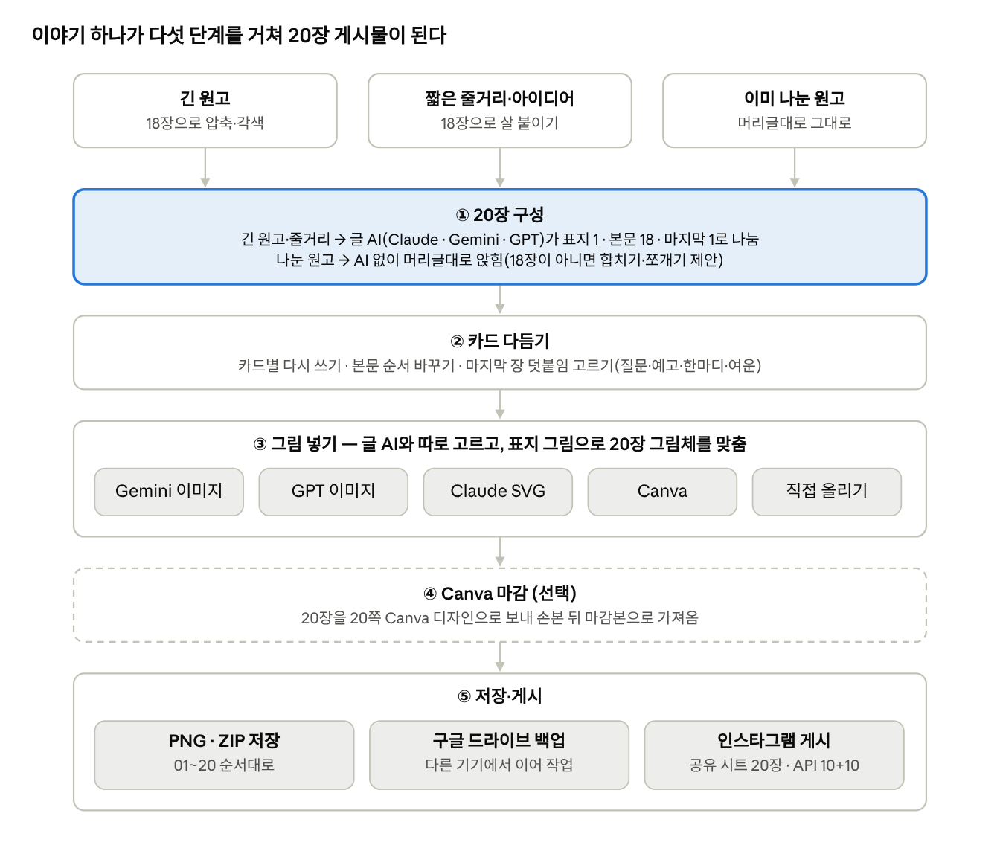
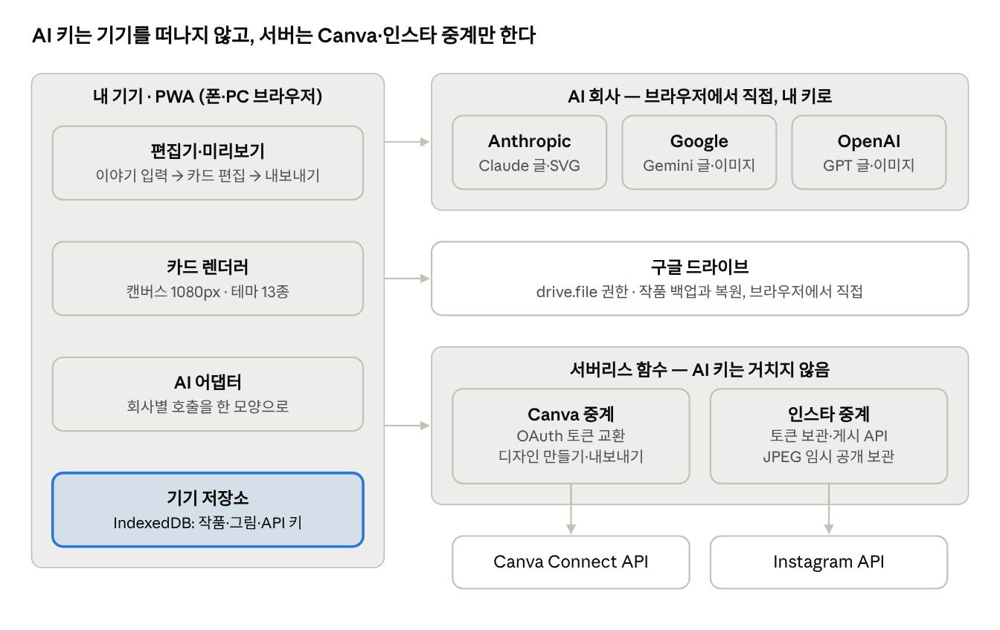
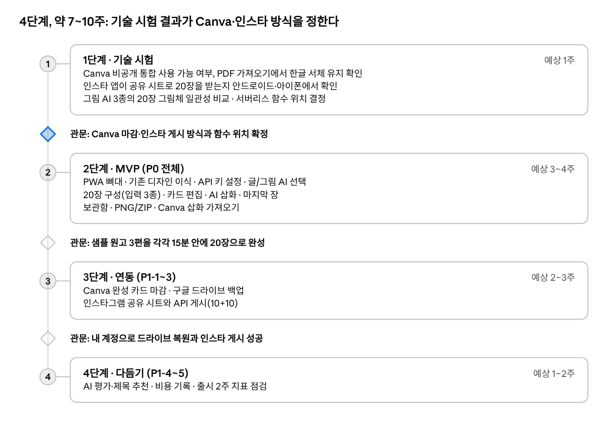

# 카드소설 제작소 앱 PRD

2026-11-02 · 도구리

> 이 파일은 Claude Docs 원본 문서의 스냅샷이다. 최신본: https://claude.ai/artifact/V2as6ghep5bMCmbzk9KSAx

이야기를 넣으면 표지 1장, 본문 18장, 마지막 1장으로 된 20장짜리 카드소설을 자동으로 만들어 주는 개인용 웹앱(PWA)이다. 기존 아티팩트 「카드소설 제작소」의 화면 색·서체·카드 규격을 그대로 잇고, 글 AI(Claude·Gemini·GPT)와 그림 AI(Gemini·GPT·Claude SVG·Canva)를 따로 고르며, 구글 드라이브 백업과 인스타그램 게시까지 한 앱에서 끝낸다.

## 결정 사항 요약

질의응답으로 정한 아래 항목이 이 문서의 전제다. 방향을 바꾸려면 이 표부터 고친다.

| 항목      | 결정                                                               | 영향                                                                                      |
|-----------|--------------------------------------------------------------------|-------------------------------------------------------------------------------------------|
| 형태      | 웹앱(PWA). 폰·PC 브라우저에서 쓰고 홈 화면에 설치                  | 스토어 심사 없이 한 코드로 두 기기를 지원                                                 |
| 사용자    | 나 혼자                                                            | 로그인·결제·사용량 관리 없음                                                              |
| AI 비용   | 내 API 키를 앱 설정에 입력                                         | 키는 내 기기에만 저장. 글·그림 AI는 브라우저에서 각 사로 직접 호출                        |
| 장르      | 구분 없이 자유                                                     | 기존 미스터리 전용 구조(사건→단서→반전→질문) 대신 AI가 이야기에 맞는 흐름으로 18장을 나눔 |
| 입력      | 긴 원고, 짧은 줄거리·아이디어, 이미 나눈 원고 세 가지 모두         | 각각 압축·확장·그대로 앉히기로 처리                                                       |
| 카드 수   | 20장 고정: 표지 1 + 본문 18 + 마지막 1                             | 기존 앱의 6~20장 가변 슬라이더는 없앰                                                     |
| 마지막 장 | 작가 표기·팔로우 안내는 고정, 나머지 한 줄은 작품마다 고르기       | 독자 질문 / 다음 화 예고 / 작가 한마디 / 여운 한 줄 / 없음                                |
| 글 AI     | Claude · Gemini · GPT 중 선택                                      | 모델 목록은 각 사 API에서 불러옴                                                          |
| 그림 AI   | 글 AI와 따로 선택: Gemini 이미지 · GPT 이미지 · Claude SVG · Canva | Claude는 사진·회화형 이미지를 만들지 못해 기존처럼 SVG를 그림                             |
| Canva     | 삽화만 가져오기와 완성 카드 마감 둘 다                             | Canva 로그인에 서버가 필요해 작은 서버리스 함수를 둠                                      |
| 저장·배포 | 기기 저장 + PNG/ZIP, 구글 드라이브 백업, 인스타그램 바로 게시      | 인스타 API는 게시물 하나에 10장까지라 20장은 나눠 올리거나 공유 시트를 씀                 |
| 디자인    | 기존 아티팩트의 색·서체·크기를 기본값으로                          | 아래 ‘카드 규격과 디자인 기준’에 수치 정리                                                |

## 문제와 목표

기존 「카드소설 제작소」는 Claude 아티팩트 안에서만 AI가 돌고, 미스터리 한 장르와 SVG 삽화에 묶여 있다. 그래서 원고가 있어도 20장으로 다시 나누고, 그림을 따로 구하고, 인스타에 올리는 일을 손으로 해야 한다.

**문제**

- **AI가 claude.ai 밖에서 멈춘다.** 파일이나 폰 브라우저로 열면 초안·그림·평가 버튼이 모두 숨겨진다.

- **장르가 고정돼 있다.** 프롬프트·카드 종류(단서·반전)·평가 기준(공정성)이 미스터리용이라 감동·로맨스·동화 원고에는 맞지 않는다.

- **그림 선택지가 좁다.** Claude가 그린 SVG만 가능해, 회화·사진 느낌의 삽화는 다른 도구에서 만들어 한 장씩 올려야 한다.

- **기기를 옮기면 끊긴다.** 작품이 그 브라우저에만 저장돼 PC에서 쓰고 폰에서 올리는 흐름이 막힌다.

**목표** (목표치는 출시 후 한 달 사용으로 검증할 가설)

1.  **빠른 초안:** 원고를 넣고 20장 글이 채워지기까지 2분 이내.

2.  **한 자리에서 완성:** 입력부터 그림 포함 20장 저장까지 15분 이내, 다른 앱을 열지 않고.

3.  **쓸 만한 초안:** 첫 초안의 본문 18장 중 60% 이상을 글 수정 없이 쓴다.

4.  **AI 교체 자유:** 글 AI 3사 × 그림 AI 4종 어느 조합으로도 같은 흐름으로 20장을 완성한다.

5.  **기기 간 이어 작업:** PC에서 만든 작품을 폰에서 1분 안에 열어 게시한다.

## 하지 않을 것

1차 버전은 ‘혼자 쓰는 20장 제작 도구’에만 집중한다. 아래는 일부러 뺀다.

| 빼는 것                          | 이유                                                                                           |
|----------------------------------|------------------------------------------------------------------------------------------------|
| 회원가입·로그인·결제             | 혼자 쓰는 도구다. 공개 서비스로 바꾸려면 따로 기획한다.                                        |
| iOS·안드로이드 스토어 출시       | PWA는 아이폰 사파리·안드로이드 크롬 모두 홈 화면 설치가 된다. 심사 비용에 비해 얻는 것이 없다. |
| 카드 수 가변(20장 외)            | 20장 고정이 요구사항이다. 카드는 배열로 저장해 나중에 열 수 있게만 둔다(P2).                   |
| 앱 안 그림 편집기(레이어·브러시) | 손볼 그림은 Canva로 보낸다. 앱은 자르기·위치 조정만 한다.                                      |
| 영상·릴스 변환, 음성 낭독        | 1차 산출물은 카드 이미지 묶음이다.                                                             |
| 여러 사람 동시 편집·공유 갤러리  | 혼자 쓰는 도구라 필요 없다.                                                                    |
| 서버에 AI API 키 보관            | 키는 기기에만 둔다. 서버리스 함수는 Canva·인스타 토큰 교환과 게시용 이미지 임시 보관만 한다.   |

## 사용 흐름

사용 흐름 · 입력 3종, 5단계

나눈 원고만 글 AI를 건너뛰고, 나머지 단계는 입력 방식과 상관없이 같다. Canva 마감(④)은 건너뛸 수 있다.

## 사용자 스토리

사용자는 카드소설을 인스타그램에 연재하는 작가 한 사람이다. 단계별로 묶고, 단계 안에서는 중요한 순서다.

**이야기 넣기**

1.  작가로서 완성된 긴 원고를 붙여 넣으면 본문 18장 분량으로 압축·각색되길 원한다. 원고를 다시 쓰지 않고 카드로 옮기려고.

2.  작가로서 몇 줄짜리 줄거리만 적어도 18장 이야기로 살을 붙여 받고 싶다. 아이디어만 있을 때도 시작하려고.

3.  작가로서 ‘표지 / 1페이지 … / 마지막 페이지’로 이미 나눈 원고는 AI를 거치지 않고 그대로 카드에 앉히고 싶다. 내 문장을 지키려고.

4.  작가로서 나눈 원고가 18장보다 많거나 적을 때 어느 카드를 합치거나 쪼갤지 미리 보고 고르고 싶다.

**AI 고르기**

5.  작가로서 글 AI와 그림 AI를 따로 고르고 작품마다 바꾸고 싶다. 글은 Claude, 그림은 Gemini처럼 각자 잘하는 쪽을 쓰려고.

6.  작가로서 API 키를 한 번만 넣고 잊고 싶다. 틀린 키는 저장할 때 바로 알려 주길 원한다.

7.  작가로서 그림 20장을 만들기 전에 예상 비용을 보고 싶다.

**다듬기**

8.  작가로서 카드마다 글을 고치고, 마음에 안 드는 카드만 AI에게 다시 쓰게 하고 싶다.

9.  작가로서 등장인물 생김새와 그림체가 20장 내내 같았으면 한다. 독자가 한 이야기로 느끼게.

10. 작가로서 마지막 장의 작가 표기·팔로우 문구는 한 번 정해 두고, 덧붙일 한 줄(질문·예고 등)만 작품마다 고르고 싶다.

**그림과 Canva**

11. 작가로서 마음에 안 드는 삽화 한 장만 Canva에서 손보고 그 카드로 바로 돌려받고 싶다.

12. 작가로서 20장이 다 되면 Canva로 통째 보내 글자 배치까지 마감하고, 마감본을 앱으로 가져와 저장·게시하고 싶다.

**저장과 게시**

13. 작가로서 PC에서 만든 작품을 구글 드라이브에 백업해 폰에서 이어 열고 싶다.

14. 작가로서 20장을 앱에서 바로 인스타그램에 올리고 캐러션·해시태그도 함께 넣고 싶다.

**예외 상황**

15. 작가로서 AI가 실패하거나 사용량 한도에 걸려도 이미 만든 카드가 날아가지 않길 원한다. 실패한 카드만 다시 시도하려고.

16. 작가로서 인터넷이 끊겨도 저장된 작품을 열고 글을 고치고 싶다. AI·연동 기능만 꺼지면 된다.

17. 작가로서 원고가 너무 길어 AI 입력 한도를 넘으면, 어디까지 쓸지 안내받고 싶다.

## 필수 요구사항(P0)

P0 열한 가지가 되면 ‘이야기를 넣으면 그림까지 들어간 20장이 나온다’는 핵심이 완성된다. 각 항목의 체크 목록이 인수 기준이다.

### P0-1 앱 뼈대(PWA)

홈 화면 설치, 오프라인 열기, 자동 저장. 서체는 앱에 내장해 오프라인에서도 카드가 같은 모양으로 그려진다.

- [ ] 안드로이드 크롬·아이폰 사파리·PC 크롬에서 홈 화면 설치가 된다.

- [ ] 비행기 모드에서 저장된 작품을 열고 글을 고칠 수 있다. AI·연동 버튼은 ‘인터넷 연결이 필요해요’로 잠긴다.

- [ ] 편집 후 1초 안에 기기에 저장되고, 새로고침해도 그대로다.

### P0-2 API 키 설정

설정 화면에 Anthropic·Google(Gemini)·OpenAI 키를 넣는다. 같은 회사의 글·그림 모델은 키 하나를 함께 쓴다. 키는 기기 저장소에만 두고, 해당 회사 API에만 보낸다.

- [ ] 저장할 때 각 사의 모델 목록 조회로 키를 확인하고, 실패하면 사유(잘못된 키·권한 없음·네트워크)를 보여 준다.

- [ ] 키는 끝 4자리만 보이고, 「키 지우기」로 즉시 삭제된다.

- [ ] 네트워크 기록을 보면 키가 해당 AI 회사 도메인 말고는 어디에도 실리지 않는다.

### P0-3 글 AI·그림 AI 선택

글 AI(Claude·Gemini·GPT)와 모델, 그림 AI(Gemini 이미지·GPT 이미지·Claude SVG·Canva·직접 올리기)를 따로 고른다. 작품마다 마지막 조합을 기억한다.

- [ ] 글 AI 3종 × 그림 AI 4종, 12개 조합 모두 20장 완성까지 진행된다.

- [ ] 키가 없는 회사는 ‘키 필요’로 표시되고, 고르면 설정 화면으로 간다.

- [ ] 모델 목록은 각 사 API에서 불러오고, 앱 업데이트 없이 새 모델을 고를 수 있다.

### P0-4 이야기 → 20장 자동 구성

입력란 하나에 붙여 넣으면 형태를 자동 판별하고, 바꿀 수도 있다. 긴 원고는 18장으로 압축·각색, 짧은 줄거리는 확장, 이미 나눈 원고는 기존 머리글 규칙(표지 / N페이지 / 마지막 페이지)대로 앉힌다. AI 한 번의 응답으로 표지(제목·훅), 본문 18장, 마지막 장 덧붙임, 캐러션·해시태그, 그림용 스타일 설정(인물·배경·그림체)을 함께 받는다.

- [ ] 8,000자 원고를 넣으면 2분 안에 표지 1 + 본문 18 + 마지막 1이 채워진다.

- [ ] 세 줄 줄거리를 넣으면 본문 18장이 각 40~90자로 채워진다. 범위를 벗어난 카드는 글자 수가 강조색으로 표시된다.

- [ ] 나눈 원고가 18장이 아니면 합치기·쪼개기 후보를 미리 보여 주고, 확인 전에는 카드를 바꾸지 않는다.

- [ ] 입력이 모델 한도를 넘으면 요약본으로 진행할지 묻는다.

- [ ] 생성 중 「중단」이 있고, 중단하거나 실패해도 기존 카드는 그대로다.

### P0-5 카드 편집기

기존 편집 화면(번호·그림 썸네일·머리말·본문·글자 수·머리말 표시 여부)을 잇되, 20장 고정이라 추가·삭제 대신 ‘비우기’를 둔다.

- [ ] 표지와 마지막 장은 위치가 고정되고, 본문 18장은 끌어서 순서를 바꾼다.

- [ ] 카드별 「다시 쓰기」는 앞뒤 카드를 참고해 그 카드만 바꾸고, ‘더 짧게’ 같은 요청을 한 줄 덧붙일 수 있다.

- [ ] 실행 취소로 최근 20단계까지 되돌린다.

### P0-6 카드 그리기(기존 디자인 이식)

기존 캔버스 렌더러를 옮겨온다. 너비 1080px, 비율 4종, 테마 13종, 서체 5종, 그림은 위·글은 아래, 바닥글 ‘01 / 20’. 수치는 ‘카드 규격과 디자인 기준’을 따른다.

- [ ] 기존 샘플 「젖지 않은 우산」을 같은 테마·비율로 그리면 글자 위치·크기가 기존 아티팩트와 같다.

- [ ] 글이 넘치면 본문을 2px씩 줄여 최소 28px까지 맞추고, 그래도 넘치면 경고한다.

- [ ] 글을 고치면 0.2초 안에 미리보기가 바뀐다.

### P0-7 AI 삽화

카드별 또는 한 번에 20장을 그린다. 모든 그림 요청에 같은 스타일 설정(인물 생김새·배경·그림체)을 넣고, 표지를 먼저 그린 뒤 그 그림을 참조 이미지로 넘겨(지원하는 모델만) 20장의 그림체를 맞춘다. Claude SVG는 기존 화풍 가이드와 SVG 정리 규칙을 그대로 쓴다.

- [ ] 「모든 그림 그리기」는 2장씩 동시에 만들고, 실패한 카드만 표시해 다시 시도할 수 있다.

- [ ] 시작 전에 ‘이미지 20장, 예상 비용 약 \$X’ 확인 창이 뜬다. 장당 단가는 설정에서 고칠 수 있다.

- [ ] 그림 안에 글자를 넣지 말라는 규칙이 모든 프롬프트에 들어간다.

- [ ] 직접 올린 이미지는 자르기 위치(위·가운데·아래)를 고를 수 있다.

### P0-8 마지막 장(아웃트로)

시리즈명·작가 핸들·팔로우 문구는 설정에 한 번 넣으면 고정으로 들어간다. 덧붙임은 독자 질문 / 다음 화 예고 / 작가 한마디 / 여운 한 줄 / 없음 중 작품마다 고르고, AI가 이야기에 맞춰 쓴다.

- [ ] 설정의 작가 표기·팔로우 문구가 모든 새 작품에 들어간다.

- [ ] 덧붙임 종류를 바꾸면 그 종류로 한 줄(60자 이내)을 새로 쓴다.

- [ ] ‘없음’이면 고정 요소만 가운데 정렬로 배치된다.

### P0-9 작품 보관함

기존 보관함을 잇는다. 자동 저장, 사본 보관, 삭제, 파일로 내보내기·가져오기.

- [ ] 목록에 표지 썸네일·제목·수정 시각이 보인다.

- [ ] 내보낸 파일을 다른 브라우저에서 가져오면 그림까지 그대로 열린다.

### P0-10 내보내기

카드 한 장 PNG/JPG, 20장 ZIP, 캐러션 복사. 폰에서는 공유 시트로 20장을 다른 앱에 넘길 수 있다.

- [ ] ZIP에 01~20 순서로 20장이 들어 있고, 크기는 고른 비율(예: 1080×1350)이다.

- [ ] 「캐러션 복사」는 제목·훅·해시태그 6~8개를 붙여 넣기 좋게 복사한다.

### P0-11 Canva로 삽화 만들기

카드의 「Canva에서 그리기」를 누르면 그림 자리 크기(예: 1:1 카드는 1080×640)의 Canva 디자인이 새 탭에 열린다. AI 그림이 있으면 그 그림을 깔아 둔다. 작업을 끝내고 돌아오면 앱이 디자인을 PNG로 내보내 그 카드에 넣는다.

- [ ] Canva 계정 연결은 처음 한 번만 하고, 이후에는 버튼 하나로 디자인이 열린다.

- [ ] Canva에서 돌아오거나 「Canva에서 가져오기」를 누르면 30초 안에 그 카드 그림이 바뀐다.

- [ ] 가져온 그림에는 ‘Canva’ 표시가 붙고, 언제든 같은 디자인을 다시 열 수 있다.

## 추가 요구사항(P1·P2)

P1은 질의응답에서 고른 기능이라 빼지 않고, P0 다음 단계에서 바로 넣는다. P2는 지금 만들지 않지만 나중에 막히지 않게 설계만 열어 둔다.

### P1-1 Canva에서 완성 카드 마감

20장을 20쪽짜리 Canva 디자인으로 보낸다. 카드를 글자가 살아 있는 PDF로 만들어 Canva 디자인 가져오기로 열고, 마감이 끝나면 쪽마다 PNG로 내보내 ‘마감본’으로 가져온다. 글자를 살리기 어려우면 글자가 박힌 이미지 20장으로 보낸다.

- [ ] 버튼 하나로 20쪽 Canva 디자인이 만들어지고, Canva에서 글자를 고칠 수 있다.

- [ ] 「마감본 가져오기」로 20장이 들어오고, 내보내기·게시에는 마감본이 쓰인다.

- [ ] 마감본을 가져온 뒤 앱에서 글을 고치면 ‘Canva 마감본과 달라졌어요’ 경고가 뜬다.

### P1-2 구글 드라이브 백업

내 드라이브의 ‘카드소설 제작소’ 폴더에 작품(글 JSON + 그림)을 올리고 내린다. 앱이 만든 파일만 다루는 권한(drive.file)만 요청한다.

- [ ] 구글 로그인 한 번 뒤 「드라이브에 백업」으로 20장 작품이 1분 안에 올라간다.

- [ ] 다른 기기에서 「드라이브에서 열기」로 같은 작품이 그림까지 열린다.

- [ ] 같은 작품을 두 기기에서 고쳤으면 덮어쓰지 않고 어느 쪽을 쓸지(둘 다 보관 포함) 묻는다.

### P1-3 인스타그램 바로 게시

두 길을 둔다. 폰에서는 공유 시트로 20장을 인스타 앱에 넘기고 캐러션을 복사해 둔다. API 직접 게시는 프로페셔널 계정을 연결해 앱에서 끝내되, API가 게시물당 10장까지라 1~10장과 11~20장을 두 게시물로 나눠 올린다.

- [ ] 폰에서 「인스타로 공유」를 누르면 20장이 순서대로 인스타 앱에 넘어가고 캐러션이 복사된다.

- [ ] 「바로 게시」는 카드를 JPEG로 바꿔 10장씩 두 게시물로 올리고, 게시 링크를 보여 준다. 두 번째 캐러션에는 이어지는 글임을 표시한다.

- [ ] 비율이 3:4·9:16이면 「바로 게시」가 잠기고, 1:1·4:5로 바꾸라고 안내한다.

### P1-4 AI 평가·제목 추천

기존 평가 기능을 장르와 상관없는 기준으로 바꾼다. 훅 · 몰입과 리듬 · 일관성(인물·설정) · 전환(반전·감정 고조) · 마무리 다섯 축을 각 20점으로 보고, 카드별 한 줄 평과 고칠 문장을 준다.

- [ ] 20장 평가가 1분 안에 오고, 「이 문장으로 바꾸기」로 바로 넣을 수 있다.

- [ ] 제목·훅 후보 5개를 받아 눌러서 표지에 넣을 수 있다.

### P1-5 비용·사용량 기록

작품별 AI 호출 수와 추정 비용을 기기 안에만 쌓아 보여 준다.

- [ ] 보관함에서 작품마다 ‘글 n회 · 그림 n장 · 약 \$X’가 보인다.

### P2 나중에 고려

- **카드 수 가변:** 카드를 배열로 저장하고, 구성 프롬프트가 본문 장수를 값으로 받게 둔다.

- **구조 프리셋:** 기승전결·3막·기존 미스터리(사건→단서→반전) 구조를 고를 수 있게 한다.

- **연재 관리:** 화수, 이전 화 연결, 다음 화 예고를 시리즈 단위로 묶는다.

- **다른 규격:** 스레드·블로그용 세로 긴 이미지 한 장 내보내기.

- **공개 서비스 전환:** AI 호출을 회사별 어댑터 한 곳에 모아, 나중에 서버 프록시로 바꾸기 쉽게 둔다.

## 카드 규격과 디자인 기준

모든 기본값은 기존 「카드소설 제작소」 코드에서 그대로 옮긴 값이다. 바뀜 것은 카드 수(20장 고정)와 마지막 장 구성, 장르 무관 머리말뿐이다.

### 20장 구성

| 번호  | 종류      | 들어가는 것                                                                | 글자 수                                        |
|-------|-----------|----------------------------------------------------------------------------|------------------------------------------------|
| 01    | 표지      | 시리즈명(머리말), 제목, 훅 한 줄, 표지 그림, 작가 핸들                     | 제목 2~14자, 훅 25자 이내                      |
| 02~19 | 본문 18장 | 머리말(선택, 예: 시작·전환·절정), 본문, 장면 그림                          | 본문 40~90자, 짧은 문장 2~3개, 줄바꿈 최대 1번 |
| 20    | 마지막 장 | 고정: 시리즈명·작가 핸들·팔로우 문구 / 선택: 덧붙임 한 줄, 그림(없어도 됨) | 덧붙임 60자 이내                               |

본문 머리말은 기본으로 숨기고 카드별로 켜며, 오른쪽 아래 번호는 항상 ‘02 / 20’ 형식이다.

### 카드 비율

| 비율       | 크기(px)  | 그림 기준 높이 | 용도              | 인스타 API 직접 게시 |
|------------|-----------|----------------|-------------------|----------------------|
| 1:1 (기본) | 1080×1080 | 640            | 피드 기본         | 가능                 |
| 4:5        | 1080×1350 | 800            | 피드 세로         | 가능                 |
| 3:4        | 1080×1440 | 860            | 피드 새 세로 규격 | 불가(공유 시트로)    |
| 9:16       | 1080×1920 | 1000           | 스토리·릴스       | 불가(공유 시트로)    |

### 카드 안 배치와 글자 크기

여백 100px. 그림이 있으면 카드 위쪽 37~57.5%(표지 40~55.5%)를 그림에 주고 아래로 글을 잇는다. 그림 아래 190px는 배경색으로 자연스럽게 사라지고, 전체에 종이 질감(노이즈)과 가장자리 비네트를 깔다. 카드가 1400px 이상이면 글자를 1.08배, 1800px 이상이면 1.22배로 키운다.

| 요소                | 그림 있음 | 그림 없음 | 굵기·줄 간격                             |
|---------------------|-----------|-----------|------------------------------------------|
| 표지 제목           | 92px      | 108px     | 700(나눔명조 800) · 1.25                 |
| 표지 훅             | 38px      | 40px      | 400 · 1.6, 글자색 82%                    |
| 본문 제목(있을 때)  | 52px      | 56px      | 700 · 1.25                               |
| 본문                | 42px      | 46px      | 400 · 1.68~1.7                           |
| 머리말              | 30px      | 30px      | 500, 자간 5px, 강조색                    |
| 바닥글(시리즈·번호) | 26px      | 26px      | 500, 자간 2px, 글자색 55%, 아래에서 88px |

글이 넘치면 본문을 2px씩 줄여 최소 28px(그림 없을 때 30px)까지 맞춘다.

### 카드 테마 13종(기본: 안개)

| 테마       | 배경(위→아래)       | 글자     | 강조     | 기본 서체    | 장식        |
|------------|---------------------|----------|----------|--------------|-------------|
| 안개       | \#141C2E → \#05080F | \#E6ECF5 | \#8FD3F4 | 노토 세리프  | 빛 번짐     |
| 먹         | \#1A1A1A → \#0A0A0A | \#F3EEE3 | \#E3C15C | 나눔명조     | 액자 테두리 |
| 자정       | \#33101B → \#120508 | \#F8E9EC | \#F09AA6 | 고운바탕     | 큰 번호     |
| 네온       | \#0B0B0F → \#040406 | \#EEEEF4 | \#FF4FA3 | 노토 산스    | 세로 막대   |
| 헌책       | \#2A1E12 → \#110B06 | \#F1E4C8 | \#D9A441 | 고운바탕     | 모서리      |
| 심해       | \#0B2A33 → \#03141A | \#E3F4F6 | \#4FD1C5 | 노토 세리프  | 빛 번짐     |
| 자수정     | \#261A44 → \#0D0818 | \#EEE8FA | \#C9A7FF | 고운바탕     | 빛 번짐     |
| 숲         | \#13281C → \#05100A | \#E6F0E8 | \#9BD47A | 고운바탕     | 모서리      |
| 잔불       | \#2E1810 → \#100603 | \#F6E9DF | \#FF8A4C | 노토 산스    | 세로 막대   |
| 설야       | \#22303F → \#0B1017 | \#F3F6FA | \#DCE6F5 | 나눔명조     | 액자 테두리 |
| 만화       | \#1C2144 → \#0A0C1E | \#FFFFFF | \#FFD24D | 메이플스토리 | 만화 칸     |
| 신문(밝음) | \#F1EADB → \#E2D8C3 | \#1E1A14 | \#A8322E | 나눔명조     | 액자 테두리 |
| 종이(밝음) | \#F4F2ED → \#E4E0D7 | \#23252B | \#3B5BA5 | 노토 세리프  | 모서리      |

서체 선택지는 테마 기본 · 노토 세리프 KR · 고운바탕 · 나눔명조 · 노토 산스 KR · 메이플스토리(넥슨) 여섯 가지다.

### 앱 화면 색과 서체

화면은 왼쪽 작업 영역(이야기 → 카드 편집 → 평가)과 오른쪽 미리보기(기본 너비 440px, 끌어서 조절) 두 칸이고, 980px 아래에서는 한 줄로 쌓는다. UI 글꼴은 노토 산스 KR 14px(줄 간격 1.55), 앱 이름과 단계 번호는 노토 세리프 KR이다. 버튼은 높이 36px에 완전히 둥글고, 패널 모서리는 16px, 입력칸은 10px이다.

| 토큰           | 밝은 화면 | 어두운 화면 |
|----------------|-----------|-------------|
| 배경           | \#F5F6FA  | \#121419    |
| 패널           | \#FFFFFF  | \#1B1E26    |
| 보조 패널      | \#EEF0F6  | \#232733    |
| 구분선         | \#DFE3EC  | \#313644    |
| 글자           | \#1A1C23  | \#E8EAF1    |
| 흐린 글자      | \#5F6577  | \#9AA1B4    |
| 주색(와인)     | \#9E2B3E  | \#E37A8B    |
| 주색 연한 배경 | \#FBEBEE  | \#3A1A22    |
| 미리보기 바탕  | \#1D1F27  | \#0B0C10    |

## AI 구성과 API 키

글 AI와 그림 AI는 서로 독립된 선택이다. 호출은 브라우저에서 각 회사 API로 바로 가고, 키는 기기 저장소에만 남는다. 세 회사 호출은 ‘회사별 어댑터’ 하나로 감싸, 화면과 프롬프트는 어느 회사든 같은 코드를 쓴다.

### 글 AI가 하는 일

| 작업               | 언제                            | 돌려받는 것                                                                                     |
|--------------------|---------------------------------|-------------------------------------------------------------------------------------------------|
| 20장 구성          | 이야기를 넣고 「카드로 만들기」 | 표지(제목·훅), 본문 18장(머리말·본문·장면 묘사), 마지막 장 덧붙임, 캐러션·해시태그, 스타일 설정 |
| 카드 다시 쓰기     | 카드별 버튼                     | 그 카드 본문 하나                                                                               |
| 덧붙임 다시 쓰기   | 마지막 장 종류를 바꿀 때        | 한 줄(60자 이내)                                                                                |
| Claude SVG 그림    | 그림 AI가 Claude일 때           | SVG 한 장                                                                                       |
| 평가·제목 추천(P1) | 평가 버튼                       | 점수, 카드별 한 줄, 고칠 문장, 제목 후보                                                        |

구성 응답은 한 JSON 스키마로 정하고, 각 사의 구조화 출력 기능으로 받는다. 장면 묘사는 그림 프롬프트의 재료가 되므로, 그림을 위해 글 AI를 따로 부르지 않는다.

**장르 무관 구성 규칙**

- 먼저 장르·분위기·핵심 사건을 파악하고, 18장을 대략 도입 2~3 · 전개 7~9 · 위기와 절정 4~5 · 결말 2~3으로 나눈다(강제 아님).

- 카드 한 장에 새 정보 하나, 넘길 때마다 다음이 궁금해지게 끝낸다.

- 긴 원고는 작가의 문체·시점·인물 이름을 지키고, 눈에 띄는 문장은 원문 그대로 살린다.

- 짧은 줄거리는 입력에 없는 설정을 더하되 입력과 모순되지 않게 한다.

- 감탄사·이모지 없이, 잔혹·선정 묘사 없이 쓴다(기존 규칙 유지).

### 그림 AI 선택지

| 그림 AI       | 필요한 것           | 결과물      | 20장 그림체 맞추기                      | 비고                                                                 |
|---------------|---------------------|-------------|-----------------------------------------|----------------------------------------------------------------------|
| Gemini 이미지 | Google AI Studio 키 | PNG         | 스타일 설정 + 표지 그림을 참조 이미지로 | Nano Banana 계열. 모델 ID는 개발 시점 목록에서 고름                  |
| GPT 이미지    | OpenAI 키           | PNG         | 스타일 설정 + 참조 이미지               | gpt-image 계열. 정해진 크기 중 가장 가까운 가로형으로 만들고 잘라 씀 |
| Claude SVG    | Anthropic 키        | SVG         | 기존 화풍 가이드·예시 SVG + 스타일 설정 | 빠름(몇 초)·정밀(30초 안팎) 두 단계, 기존과 동일                     |
| Canva         | Canva 계정 연결     | PNG         | 사람이 직접 맞춤                        | 서버리스 함수 필요                                                   |
| 직접 올리기   | 없음                | 이미지 파일 | \-                                      | 오프라인에서도 됨                                                    |

그림은 카드 비율의 그림 자리(예: 1:1 카드는 1080×640, 약 27:16)에 맞춰 가장 가까운 가로형 크기로 만들고 가운데를 기준으로 자른다. 모든 프롬프트에 ‘글자 없음, 아래 1/4은 어둡고 단순하게(글이 이어짐)’를 넣는다.

### 키 보관과 오류 처리

- **보관:** 키는 기기 저장소(IndexedDB)에만 두고, 드라이브 백업·내보내기 파일에는 넣지 않는다. 선택으로 잠금 비밀번호를 걸면 브라우저 암호화(Web Crypto)로 잠걼 둔다.

- **위험 줄이기:** 브라우저에서 직접 부르는 방식은 기기를 만지는 사람이 키를 볼 수 있다. 설정 화면에서 각 사 콘솔의 월 사용 한도 설정을 권하고, 공용 기기 경고를 띄운다. Anthropic API는 브라우저 직접 호출용 헤더가 필요하다.

- **오류:** 요청 과다(429)는 간격을 늘려 2번 다시 시도한 뒤 안내한다. 형식이 깨진 응답은 1번 자동 재요청한다. 거절·입력 초과·인증 실패는 기존 안내 문구를 쓴다.

- **비용:** 장당 이미지 단가와 글 토큰 단가는 가격이 자주 바뀌므로 설정 표로 두고 사용자가 고칠 수 있게 한다.

## 외부 연동

구글 드라이브는 브라우저만으로 되지만, Canva와 인스타그램은 서버가 꼭 필요하다. 그래서 ‘서버 없음’ 대신 호출할 때만 도는 서버리스 함수 몇 개를 둔다. AI 키는 여기를 거치지 않는다.

| 연동                 | 서버 필요 | 이유                                                                                                                                  | 확인된 제약                                                                                                                                                                |
|----------------------|-----------|---------------------------------------------------------------------------------------------------------------------------------------|----------------------------------------------------------------------------------------------------------------------------------------------------------------------------|
| Canva                | 필요      | 토큰 교환에 클라이언트 비밀키가 들어가 브라우저 호출은 CORS로 막힘 ([Canva 문서](https://www.canva.dev/docs/connect/authentication/)) | OAuth 2.0 + PKCE. 리프레시 토큰은 한 번만 쓸 수 있음                                                                                                                       |
| 구글 드라이브        | 불필요    | 브라우저용 구글 로그인(클라이언트 ID만)으로 토큰을 받음                                                                               | 앱이 만든 파일만 다루는 drive.file 권한                                                                                                                                    |
| 인스타그램 API 게시  | 필요      | 토큰 보관, 그리고 인스타가 가져갈 공개 이미지 주소가 필요                                                                             | JPEG만, 비율 4:5~1.91:1, 너비 320~1440px, 8MB 이하, 캐러셀 10장까지, 24시간 50건 ([Meta 문서](https://developers.facebook.com/docs/instagram-platform/content-publishing)) |
| 인스타그램 공유 시트 | 불필요    | 폰 브라우저의 파일 공유(Web Share)로 인스타 앱에 넘김                                                                                 | 인스타 앱이 20장을 한 번에 받는지는 실기기 확인 필요                                                                                                                       |

### Canva 흐름

1.  **연결(처음 한 번):** 앱 → Canva 로그인 → 서버리스 함수가 토큰을 받아 보관하고, 앱에는 연결 여부만 알린다.

2.  **삽화만(P0-11):** 그림 자리 크기로 디자인 만들기(AI 그림이 있으면 에셋으로 올려 깔기) → Canva 편집 화면 열기 → 돌아오기 → PNG 내보내기 작업을 기다렸다가 내려받아 카드에 넣기.

3.  **완성 카드 마감(P1-1):** 글자가 살아 있는 20쪽 PDF 만들기 → 디자인 가져오기 → Canva에서 마감 → 쪽별 PNG 내보내기 → 마감본으로 저장.

4.  **돌아오기:** Canva 개발자 포털의 ‘돌아가기(Return navigation)’ 주소를 앱으로 설정하고, 동작하지 않으면 「Canva에서 가져오기」 버튼으로 대신한다.

주의할 점: 브랜드 템플릿 자동 채우기(Autofill)는 Canva Enterprise 전용이라 쓰지 않는다. PDF를 가져올 때 한글 서체가 다른 서체로 바뀔 수 있어 1단계 시험에서 확인한다. 내보내기 링크는 곧 만료되므로 받자마자 내려받는다.

### 구글 드라이브 흐름

작품 하나는 드라이브의 ‘카드소설 제작소/작품명_ID’ 폴더에 work.json과 images/01~20 파일로 저장한다. 열 때는 기기의 수정 시각과 드라이브 수정 시각을 비교해, 둘 다 바뀌었으면 사용자에게 묻는다. 구글 클라우드 프로젝트와 OAuth 동의 화면은 테스트 모드(본인 계정만 등록)로 두면 된다.

### 인스타그램 흐름

- **공유 시트(기본, 폰):** 카드 20장을 JPEG로 만들어 공유 → 인스타 앱 선택 → 앱에서 캐러션 게시. 캐러션은 클립보드에 복사해 둔다.

- **API 직접 게시:** 인스타 프로페셔널(비즈니스·크리에이터) 계정과 Meta 개발자 앱이 필요하다. 서버리스 함수가 JPEG를 임시 공개 저장소에 올리고 → 캐러셀 항목 10개 → 캐러셀 컨테이너 → 게시를 1~10장, 11~20장 두 번 돌린 뒤 임시 파일을 지운다.

- 캐러셀은 첫 장 비율로 모두 잘리므로, 게시 전에 20장 비율이 같은지 확인한다.

## 시스템 구성

시스템 구성 · 기기, 외부 API, 서버리스 함수

글·그림 AI와 구글 드라이브는 브라우저에서 바로 부르고, Canva와 인스타그램만 서버리스 함수를 거친다. 권장 구현은 TypeScript + Vite 기반 PWA에 기존 캔버스 렌더러를 옮기는 것이며, 함수를 둘 곳은 열린 질문이다.

## 성공 지표

혼자 쓰는 앱이라 지표는 기기 안 사용 기록(외부 전송 없음)으로 잰고, 설정의 ‘통계’ 화면에서 본다. 출시 2주·1달·3달에 한 번씩 점검한다. 목표치는 모두 가설이다.

| 구분 | 지표             | 정의                                                 | 목표                        | 점검 |
|------|------------------|------------------------------------------------------|-----------------------------|------|
| 선행 | 초안 시간        | 「카드로 만들기」부터 20장 글이 채워지기까지, 중앙값 | 2분 이내                    | 2주  |
| 선행 | 초안 채택률      | 첫 초안 본문 18장 중 글을 고치지 않고 내보낸 비율    | 60% 이상                    | 2주  |
| 선행 | 그림 다시 그리기 | 작품당 다시 그린 카드 수                             | 4장 이하                    | 2주  |
| 선행 | AI 실패율        | 자동 재시도 후에도 실패한 요청 비율                  | 5% 이하                     | 2주  |
| 선행 | 작품당 AI 비용   | 글 + 그림 20장 추정 비용                             | \$2 이하(단가 확정 후 조정) | 1달  |
| 후행 | 완성 시간        | 입력부터 ZIP 저장 또는 게시까지, 중앙값              | 15분 이내                   | 1달  |
| 후행 | 월 발행 편수     | 한 달간 내보낸 작품 수                               | 출시 전 한 달의 2배         | 3달  |
| 후행 | 게시 성공률      | 인스타 게시 시도 중 성공 비율                        | 95% 이상                    | 3달  |
| 후행 | 이어 작업        | 드라이브에서 열기 실패 횟수                          | 0건                         | 3달  |

## 열린 질문

차단 항목은 해당 기능을 시작하기 전에 답이 필요하다. ‘개발’ 질문은 1단계 기술 시험에서 확인한다.

| 질문                                                                                                                                 | 답할 사람     | 차단       |
|--------------------------------------------------------------------------------------------------------------------------------------|---------------|------------|
| API 게시는 게시물당 10장까지다. 20장을 두 게시물(10+10)로 나눠 올려도 되는가, 아니면 한 게시물을 위해 공유 시트만 쓸까?              | 사용자        | P1-3 차단  |
| 인스타 앱이 공유 시트로 20장을 한 번에 받는가(안드로이드·아이폰 실기기)?                                                             | 개발          | P1-3 차단  |
| Canva 연동을 개인용 비공개 통합으로 심사 없이 쓸 수 있는가, 무료 계정으로도 되는가?                                                  | 개발          | P0-11 차단 |
| Canva PDF 가져오기에서 한글 서체(노토 세리프·고운바탕·나눔명조·메이플스토리)가 유지되는가? 안 되면 글자 박힌 이미지로 보낼까?        | 개발 → 사용자 | P1-1 차단  |
| 서버리스 함수는 어디에 둘까(Vercel·Cloudflare·Firebase 중 무료 범위)?                                                                | 개발 → 사용자 | 1단계 차단 |
| 그림체 기본값: 기존 ‘어두운 밤 미스터리’ 화풍을 유지할까, 이야기마다 AI가 제안하고 프리셋(수채 동화·웹툰·사진풍 등)에서 고르게 할까? | 사용자        | P0-7 전    |
| 시리즈명(기존 ‘3분 미스터리’)·작가 핸들(기존 ‘@midnight.cards’)·팔로우 문구 기본값은 무엇으로 할까?                                  | 사용자        | 비차단     |
| AI로 만든 그림에 ‘AI 생성’ 표시를 캐러션이나 마지막 장에 넣을까?                                                                     | 사용자        | 비차단     |
| 메이플스토리 서체를 앱에 내장해 배포해도 되는가(넥슨 서체 약관)?                                                                     | 개발          | 비차단     |
| 출시 목표일이 있는가? 있으면 아래 일정을 거기에 맞춘다.                                                                              | 사용자        | 비차단     |

## 단계별 일정

단계별 일정 · 4단계, 관문 3개

정해진 마감일은 없으며, 기간은 혼자 Claude Code와 함께 만드는 경우를 가정한 예상치다. 1단계에서 Canva·인스타 방식이 막히면 3단계 범위를 줄이고, 2단계 MVP는 그대로 진행한다.

## 출처

외부 제약은 2026-11-02 웹 검색으로 확인했다. 이 환경에서는 문서 본문을 직접 열지 못했으므로, 1단계 기술 시험에서 원문을 다시 확인한다. 모델 이름은 자주 바뀌므로 구현 시점에 각 사 모델 목록을 기준으로 한다.

- [카드소설 제작소(기존 아티팩트)](https://claude.ai/artifact/UMNJWnWeDHD62PVsvjuQUz): 디자인 값, 카드 배치, 프롬프트, 보관함·내보내기 기능의 기준

- [Meta, Instagram Platform — Content Publishing](https://developers.facebook.com/docs/instagram-platform/content-publishing): JPEG 전용, 비율 4:5~1.91:1, 캐러셀 10장, 24시간 50건

- [Upload-Post, Instagram API in 2026](https://www.upload-post.com/instagram-api/): 앱에서는 20장, API는 10장이라는 차이(제3자 자료)

- [Canva Developers — Connect APIs Authentication](https://www.canva.dev/docs/connect/authentication/): OAuth 2.0 + PKCE, 토큰 교환은 백엔드에서

- [Canva Developers — Generate an access token](https://www.canva.dev/docs/connect/api-reference/authentication/generate-access-token/): 클라이언트 비밀키·CORS 제약, 리프레시 토큰 1회용

- [Google, Gemini API 릴리스 노트](https://ai.google.dev/gemini-api/docs/changelog): Nano Banana 계열 이미지 모델 현황

- [Firebase AI Logic — 지원 모델](https://firebase.google.com/docs/ai-logic/models): Gemini 이미지 모델 종료 일정

- [OpenRouter — gpt-image-2](https://openrouter.ai/openai/gpt-image-2): OpenAI 최신 이미지 모델(제3자 목록)
